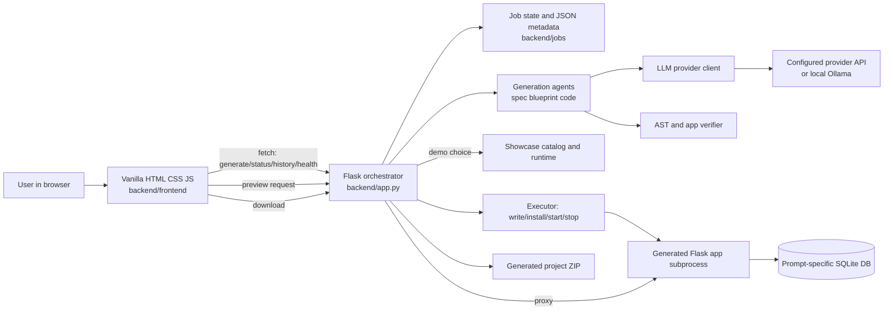
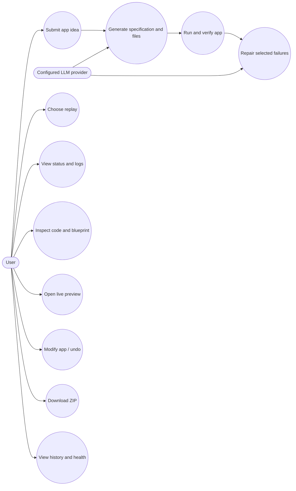
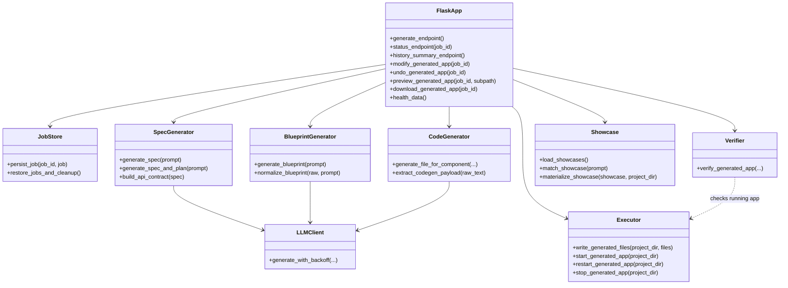
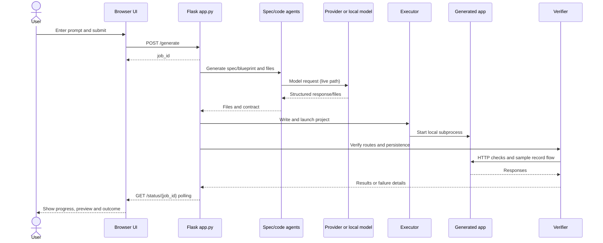
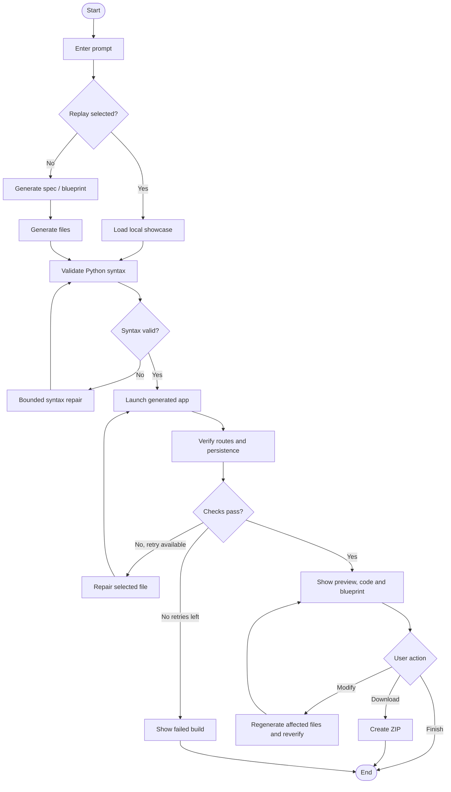
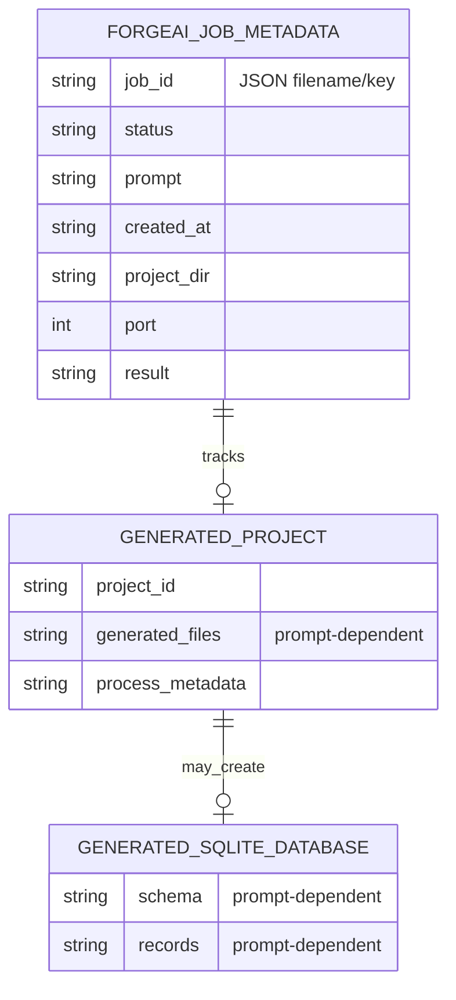

# MCA Design Phase Presentation Content — Repository Audit

> **Scope and identity check (verified 3 November 2026):** The repository in this workspace is **ForgeAI**, a local-first application generator and verification demo. It does not contain the requested AI-Powered Menstrual and Reproductive Tracker implementation. The requested `Design Phase.pptm` template was not found in the repository. This report therefore describes only ForgeAI and explicitly marks requested tracker information as unavailable. Do not present ForgeAI as the menstrual tracker unless this is the intended project.
>
> Secrets were not read or copied. `.env` was not inspected; only variable names and non-secret defaults from `backend/config.py` and `.env.example` were considered.

## 1. Project Overview

- **Title in source/docs:** ForgeAI (`README.md`, `backend/frontend/index.html`).
- **Objective:** Turn a natural-language app request into a Flask + SQLite application, run it locally, perform limited route/data checks, and show source and preview (`README.md`; `backend/app.py`; `backend/agent/`).
- **Requested tracker objective, problem statement, existing system, limitations, users:** **Not found in the project.**
- **ForgeAI problem framing:** An idea is easy to describe but harder to turn into a runnable project; asking a model for code alone does not create, start, verify, and preview a project (`docs/POSTER_TEXT.md`, `README.md`). This is ForgeAI’s framing, not an analysis of menstrual-tracker systems.
- **Proposed system as implemented for ForgeAI:** Flask orchestrates specification/blueprint, code generation, syntax validation, local launch, verification, bounded repair, preview, history and ZIP download. A local showcase replay can support a demo without fresh model generation (`backend/app.py`, `backend/agent/showcase.py`).
- **Advantages evidenced:** Inspectable output, local preview, selected automated checks, build history, focused changes/undo, ZIP download and replay mode (`README.md`, `backend/frontend/index.html`).
- **Target users:** People with an app idea who want a runnable starting point, plus exhibition visitors/judges. Tracker-specific user roles: **Not found in the project**.
- **Workflow:** Enter prompt → Flask creates job → model or replay provides app structure → files are generated/materialized → Python syntax check → generated Flask app starts → verifier exercises declared routes and persistence → bounded repair may run → user reviews logs/source/blueprint/preview and may modify, undo or download.

## 2. System Requirements

### 2A. Functional Requirements

The requirements below describe the code actually present. Menstrual cycle, fertility, symptom, educational and reproductive-health categories have no supporting tracker implementation here.

| Category | Implemented behavior | Evidence |
|---|---|---|
| Prompt intake | Accept an app prompt and optional demo replay setting; create a generation job. | `backend/app.py` `/generate`; `backend/frontend/index.html`, `script.js` |
| Specification/blueprint | Generate/normalize app structure, entity fields and route/API contract; show blueprint. | `backend/agent/spec_generator.py`, `blueprint.py`; `backend/app.py` |
| Project generation | Create project files in dependency-aware order; deterministic Flask entry point is supplied by the orchestrator. | `backend/app.py` `_generate_project_files`, `_deterministic_file`; `backend/agent/code_generator.py` |
| Syntax validation | Parse generated Python with `ast.parse`; syntax repair is bounded. | `backend/app.py` `validate_generated_project_files`, `repair_generated_syntax_errors` |
| Local execution | Write files, install generated requirements, find entry point, launch on available local port, and manage process lifecycle. | `backend/agent/executor.py` |
| Verification and repair | Check startup and contract routes; exercise a temporary record and SQLite persistence/update/read/delete when supported by the generated contract; bounded repair on failures. | `backend/agent/verifier.py`; `backend/app.py` `self_correct_generated_app` |
| Preview | Proxy supported HTTP methods to generated local app. | `backend/app.py` `/preview/<job_id>/...` |
| Status/history | Poll job status and show locally persisted job/build summaries. | `backend/app.py` `/status/<job_id>`, `/history`; `backend/frontend/script.js` |
| Download | Download generated project as ZIP. | `backend/app.py` `/download/<job_id>` |
| Modification/undo | Plan and regenerate affected files, restart and verify; preserve version for undo. | `backend/app.py` `/modify/<job_id>`, `/undo/<job_id>` |
| Health information | Report provider availability/configuration summary, model/provider, disk space and generated-app limits/count. | `backend/app.py` `/health`, `/health/data`; `backend/frontend/health.html` |
| Showcase replay | Load local catalog preset and materialize it for preview, clearly labeling replay. | `backend/showcase/catalog.json`, `backend/agent/showcase.py`, `backend/app.py` |
| QR/share affordances | Copy/share and QR actions for a preview reachable on the same network; not public hosting. | `backend/frontend/index.html`, `script.js`, `qr.js`; `/network-address` |
| Menstrual tracking/prediction/health information | **Not found in the project.** | No domain implementation in application source. |
| Registration/login/profile | **Not found in the project.** The ForgeAI UI has no user accounts. | No authentication routes or identity model found in `backend/app.py`. |
| Notifications/reminders | **Not found in ForgeAI itself.** A generated app prompt could request such behavior, but that is not a fixed ForgeAI module. | No ForgeAI notification subsystem found. |

### 2B. Non-Functional Requirements

| Quality | Verified implementation detail | Proposed goal / limitation |
|---|---|---|
| Security | Provider keys are read from environment configuration; executor filters selected sensitive variables before starting generated apps. | Generated code runs as a local subprocess under the same OS account and is **not sandboxed**. No ForgeAI user authentication/authorization found. Isolation/security review are future work (`README.md`). |
| Performance | Generation has semaphore/queue controls; generated app count and lifetime are bounded; free-port selection exists. | No performance benchmark or production load guarantee found. |
| Reliability | Job metadata restore, process management, replay, syntax check, verification and bounded repair are implemented. | Checks cover selected contract behavior only; repair can fail. No production availability guarantee. |
| Usability | Prompt examples/templates, progress, source tabs, preview, blueprint, errors and health screen exist. | Accessibility audit/usability study: **Not found in the project**. |
| Maintainability | Python modules separate orchestration, providers, generation, execution, verification and replay; tests are under `backend/tests`. | No formal coverage report or architecture conformance result found. |
| Scalability | In-process job state/locks and local subprocess controls. | Documentation calls it a single-machine exhibition prototype; no distributed queue or production multi-tenant design. |
| Data privacy | Local-first execution; Ollama is documented as local-only. | Hosted provider prompts may leave the machine; generated apps are not suitable for sensitive data without review. No tracker privacy controls exist. |
| Compatibility | Python 3.10+ is documented; local HTML/CSS/JS; Windows and Unix launch scripts exist. | Browser/device compatibility matrix: **Not found in the project**. |

## 3. System Architecture Design

### Components and technologies

- **Frontend:** Vanilla HTML/CSS/JavaScript under `backend/frontend/`; no frontend build step. Main screen `index.html`, health screen `health.html`, local QR encoder `qr.js`.
- **Backend:** Flask app in `backend/app.py`; coordinates jobs, models, generated files/processes, previews, history and downloads.
- **Agents:** `backend/agent/spec_generator.py`, `blueprint.py`, `code_generator.py`, `task_planner.py`, `design_profiles.py`, `verifier.py`, `executor.py`, `showcase.py`, `llm_client.py`.
- **Storage:** No fixed ForgeAI relational schema/model layer. Job metadata is JSON under `backend/jobs/`; generated projects are under `backend/generated_projects/`; showcase catalog is JSON (`backend/showcase/catalog.json`). Generated apps use prompt-specific SQLite schemas. No single database/table set or user table is defined by ForgeAI.
- **API communication:** Browser `fetch()` calls same-origin Flask endpoints. Preview requests are proxied to a generated app. Provider client calls configured hosted provider APIs or local Ollama.
- **Authentication:** No user sign-in flow found. Provider authentication uses environment API keys where applicable; secret values are omitted.
- **AI/ML:** Language-model-assisted specification/code generation and repair through `backend/agent/llm_client.py` and `backend/config.py`. No menstrual prediction model or fertility ML pipeline is present.
- **External integrations:** Provider code/config for Groq, Gemini, Mistral, NVIDIA NIM and Ollama; HTTP via `requests`. No email/SMS/push or health platform integration found.

### Architecture diagram

### Request flow

1. Browser submits prompt and replay setting to `POST /generate`.
2. Flask creates a job ID, queues work and stores status metadata locally.
3. The selected path loads a showcase, or generates a normalized specification/blueprint and contract through configured model calls.
4. Files are generated; in blueprint mode Flask supplies deterministic `app.py`. Python files undergo syntax parsing.
5. Executor writes files, installs declared requirements and starts the app as a local subprocess.
6. Verifier probes app routes and persistence using its contract. A bounded repair cycle may run after failure.
7. Browser polls `/status/<id>` and displays logs, files, blueprint, verification and the `/preview/<id>/` iframe.
8. User may modify/undo, view history/health or download ZIP.

### API routes observed

`GET /`, `GET /style.css`, `GET /script.js`, `POST /generate`, `GET /download/<job_id>`, `GET /status/<job_id>`, `GET /history`, `GET /network-address`, `GET /health`, `GET /health/data`, `GET /debug`, `POST /modify/<job_id>`, `POST /undo/<job_id>`, and `GET/POST/PUT/PATCH/DELETE/OPTIONS /preview/<job_id>/...` (`backend/app.py`).

## 4. UML Diagrams

These diagrams represent ForgeAI, not the absent tracker. Internal functions are grouped into components for clarity; they do not imply a domain class hierarchy.

### 4.1 Use case diagram

**Explanation:** The user works through a browser. A configured model may create or repair an app; local components run and check it. Replay uses prepared examples.

### 4.2 Class/component diagram

**Explanation:** Flask coordinates specialized Python modules. The agent modules plan/generate; executor and verifier run/check the result. These are code modules/functions, not ORM entities.

### 4.3 Sequence diagram

**Assumption:** This is the live path. Replay bypasses live model generation and uses stored showcase files. Status updates use polling in `backend/frontend/script.js`.

### 4.4 Activity diagram

**Explanation:** Syntax and runtime checks gate the result. Repairs are limited; a successful verifier run covers only the checks it performs.

## 5. Database Design

### Finding

- **ForgeAI database name/technology:** No central ForgeAI SQL database or ORM schema found. Job status/summary is JSON under `backend/jobs/`; generated files/process records live under `backend/generated_projects/` (`backend/app.py`).
- **Generated-app database:** Generated models/routes define prompt-specific SQLite schemas. There is no universal table definition in ForgeAI. `backend/agent/executor.py`, `verifier.py` and `app.py` handle generated-app execution/checking.
- **Showcase schemas:** `backend/showcase/catalog.json` defines entities/fields for six replay presets; they are example apps, not the menstrual tracker or a shared ForgeAI database.
- **Authentication tables:** None found. No account model/login table.
- **Fields, PK/FK, constraints and indexes:** No fixed ForgeAI SQL definitions, therefore **Not found in the project**. Per-generated-app schemas vary. Do not report period/user/symptom/cycle tables from cache artifacts or generated examples as integrated implementation.

### ERD (actual storage boundary)

**Important:** This is a conceptual storage map, not a relational ERD with SQL foreign keys. JSON metadata and process files are not SQL tables. `_persist_job` records fields such as status, current step, spec/plan, project path/port, result, prompt, timestamps/duration, app name, versions, generated files, preview/replay/verification.

| Storage | Format | Contents / role |
|---|---|---|
| Job metadata | JSON file | Status, prompt/spec/plan, path/port, result and version/verification details needed for restoration/history. |
| Showcase catalog | JSON | Preset identifiers, descriptions and entity/field definitions. |
| Generated app database | SQLite, generated dynamically | Data tables for the generated app; structure varies. |
| Authentication tables | None found | No ForgeAI authentication implementation. |

## 6. Module Design

| Module | Purpose, input → processing → output | Important files |
|---|---|---|
| Web UI | Prompt/replay input → fetch and poll → build workspace/history/preview. | `backend/frontend/index.html`, `script.js`, `style.css`, `qr.js` |
| Flask orchestration | Request/job data → queue, persist and invoke components → status/results. | `backend/app.py` |
| Specification/API contract | Prompt → normalized specification/route contract and plan → generator/verifier input. | `backend/agent/spec_generator.py`, `task_planner.py`, prompts |
| Blueprint | Prompt/model data → normalized entities/fields → visible blueprint/generation structure. | `backend/agent/blueprint.py`, `design_profiles.py` |
| Code generation | Spec/component/context → provider output parsing → project files. | `backend/agent/code_generator.py`, `backend/prompts/` |
| Provider client | Prompt/model/config → provider routing, retry/throttle/cache → response/metrics. | `backend/agent/llm_client.py`, `gemini_client.py`, `backend/config.py`, `backend/llm_cache/` |
| Executor | Files/dependencies → write/install/port/launch/restart/stop → running local app. | `backend/agent/executor.py` |
| Verifier/repair | Contract and running URL → route/data checks and diagnostics → results/repair input. | `backend/agent/verifier.py`, `backend/app.py` |
| Showcase/replay | Catalog entry → materialize local app → replay result. | `backend/agent/showcase.py`, `backend/showcase/catalog.json`, `runtime/` |
| Health/history/download/preview | IDs and runtime state → summary/proxy/ZIP/diagnostics → browser results. | `backend/app.py` |

No menstrual/reproductive tracker module exists. Modules communicate through Python calls and shared job/spec/contract dictionaries; browser/server communication uses same-origin HTTP.

## 7. User Interface Design

These are actual ForgeAI screens/areas, not tracker screens.

| Screen or area | Purpose | Source |
|---|---|---|
| Home/prompt | Enter idea, choose replay, browse examples/templates and recent builds. | `backend/frontend/index.html`, `script.js` |
| Build workspace | Show pipeline, log, generated files, preview, blueprint, verification, repair and actions. | Same files; `style.css` |
| Generated app preview | Embedded iframe, desktop/phone width, refresh/share/QR. | `index.html`, `script.js`, `qr.js`; `/preview/...` |
| Modification/version area | Request focused change and undo prior version when supported. | `index.html`, `script.js`; `/modify`, `/undo` |
| System health | Provider/local runtime summary and refresh. | `backend/frontend/health.html`; `/health/data` |
| Login/registration/profile/cycle/prediction | **Not found in the project.** | — |

**Screenshots to capture manually:** ForgeAI home; successful build/replay showing log, source, blueprint and preview; verification result; modification/version area; `/health`. Clearly label any showcase as replay. For a tracker presentation, obtain the correct repository before capturing tracker screenshots.

## 8. Technology Stack

| Area | Verified technology | Purpose / evidence |
|---|---|---|
| Language | Python | Backend, agents, execution and verification. |
| Backend | Flask | Routes and static UI (`backend/app.py`, `backend/requirements.txt`). |
| Frontend | HTML, CSS, vanilla JavaScript | Local browser UI; no frontend build step/package manifest found. |
| Database/storage | SQLite (`sqlite3`) for generated apps; JSON job metadata for ForgeAI | Generated persistence/checking; no central ForgeAI SQL schema. |
| AI/model integrations | Groq, Gemini, Mistral, NVIDIA NIM, Ollama | Configurable provider clients (`backend/agent/llm_client.py`, `backend/config.py`); actual provider depends on local configuration. |
| Packages | Flask, python-dotenv, google-generativeai, google-genai, requests, groq (`backend/requirements.txt`) | Web server, environment loading and provider/HTTP integration. Dependency presence alone does not prove an application feature. |
| Verification/testing | `ast`, `pytest`, `requests`, `sqlite3` | Syntax parsing, automated tests, HTTP/SQLite checks. Tests in `backend/tests/`; not run for this documentation task. |
| QR | Local `backend/frontend/qr.js` | QR code in UI. |
| Runtime tools | Python 3.10+ documented; `.venv`, `run.bat`, `run.sh` | Local setup and launch. |
| Deployment | Local Flask server; generated apps bind to loopback; LAN preview proxy documented | No cloud deployment/hosting configuration found. |

## 9. Conclusion and Future Scope

### Conclusion and achievements

The repository implements a local demonstration pipeline that accepts app descriptions, prepares structure/files, runs a generated Flask app, performs selected checks, supports bounded repair, and provides preview, history, focused changes and download. It also includes a local showcase replay. This describes ForgeAI only; it does not establish menstrual-tracker achievements.

### Current limitations

- The requested tracker project is absent from this workspace.
- Generated code runs locally without an OS-level sandbox, under the ForgeAI account.
- Verification is limited and cannot prove full correctness, security or production readiness.
- It is a single-machine exhibition prototype without multi-user production infrastructure.
- Fresh generation needs a configured provider/network; provider use may incur cost. Replay is prepared content, not fresh generation.
- No ForgeAI account/authentication system or menstrual-health privacy controls found.

### Proposed future enhancements (not implemented)

For ForgeAI, README proposes stronger per-app isolation, richer domain templates, broader UI/data tests, provider cost controls and a security-reviewed deployment workflow. General additions could include production monitoring and accessibility evaluation.

For a future menstrual tracker, if that is the intended project: validated cycle estimates with uncertainty, user-controlled reminders, privacy-by-design, secure account/data controls, clinician-reviewed education, optional mobile support and carefully evaluated prediction methods. These are proposals only; this repository contains no tracker implementation.

## 10. Presentation-Ready Content (exact 10-slide structure)

### Slide 1 — Title Slide

**Ready-to-paste bullets**
- ForgeAI: From a plain-English idea to a running local application
- Local application-generation and verification prototype
- MCA Design Phase presentation
- Presenter/team/college: add your details
- Repository checked: `C:\Users\prajw\forgeai`

**Visual:** ForgeAI home screenshot or prompt → app flow. The requested `Design Phase.pptm` template was not found here.

**Speaker notes:** “I audited the source in this workspace. It is ForgeAI, an app generator, rather than the menstrual tracker named in the request. I will present only what this code implements.”

**Terms:** *Prototype* = early working demonstration; *local* = runs on the user’s machine.

### Slide 2 — Introduction

**Ready-to-paste bullets**
- ForgeAI accepts an app idea in plain English.
- It prepares a specification/blueprint and generates a Flask project.
- It starts the app and checks selected routes and database operations.
- The interface shows logs, files, blueprint, preview and result.
- Menstrual/reproductive tracking features: not found in this repository.

**Visual:** Prompt form and pipeline (`backend/frontend/index.html`).

**Speaker notes:** “ForgeAI addresses the gap between describing an app and having a runnable first version. Its checks offer limited evidence, not proof of production quality.”

**Terms:** *Specification* = structured description of app behavior; *verification* = automated checks of selected behavior.

### Slide 3 — System Requirements

**Ready-to-paste bullets**
- **Functional:** accept prompt/replay choice; generate spec/files; check syntax; launch/verify; show status/history/preview; modify/undo; download ZIP; report health.
- **Quality evidence:** local UI, bounded app lifetime/count, persisted job summaries, bounded repair.
- **Limitations:** no ForgeAI sign-in, central relational schema or generated-code sandbox.
- Cycle prediction, fertility, symptom logging, reminders and reproductive-health information: not found.

**Visual:** Two columns for implemented functions and quality evidence, plus a “Not in repository” callout.

**Speaker notes:** “Requirements come from routes, UI controls and agent modules. A dependency alone was not treated as evidence of a feature.”

**Terms:** *Functional requirement* = action the system performs; *non-functional* = quality or operating constraint.

### Slide 4 — System Architecture Design

**Ready-to-paste bullets**
- Browser: vanilla HTML, CSS and JavaScript.
- Backend: Flask orchestrator and Python generation modules.
- Model providers: configurable hosted providers or local Ollama.
- Generated app: local Flask subprocess and prompt-specific SQLite database.
- Job history: JSON metadata; preview traffic passes through Flask.

**Diagram:** Use Section 3 architecture diagram.

**Speaker notes:** “The browser calls Flask endpoints. Flask coordinates generation, execution and verification. Each generated app is a separate local process; its database schema depends on the prompt.”

**Terms:** *API* = defined way for components to communicate; *subprocess* = separate program started by another program.

### Slide 5 — UML Diagrams

**Ready-to-paste bullets**
- Use cases: submit prompt, choose replay, inspect build, preview, modify/undo, download and view health.
- Components: Flask app, spec/blueprint/code generators, executor, verifier, showcase and provider client.
- Sequence: browser request → Flask job → generation/replay → local launch → verification → browser result.
- Activity includes syntax/runtime gates and bounded repair.

**Visual:** Put simplified use case on the slide; move class, sequence and activity diagrams (Section 4) to backup if needed.

**Speaker notes:** “These diagrams describe modules and interactions present in ForgeAI. They do not imply account classes or health-tracker entities.”

**Terms:** *Actor* = person/system interacting with software; *sequence diagram* = messages in time order.

### Slide 6 — Database Design

**Ready-to-paste bullets**
- No fixed central SQL database schema found for ForgeAI.
- Job state/history is stored as JSON metadata.
- Generated apps can create their own SQLite database and tables.
- Showcase field definitions live in a JSON catalog.
- No user, period, cycle, symptom, fertility or reminder tables found.

**Visual:** Use Section 5 storage map and label it “storage map, not SQL ERD.”

**Speaker notes:** “There is no universal generated-app schema: fields depend on the requested app. ForgeAI tracks jobs in JSON, and verifies a generated SQLite database.”

**Terms:** *Schema* = database structure; *primary key* = field that identifies a row. No tracker keys exist to report.

### Slide 7 — Module Design

**Ready-to-paste bullets**
- UI module: prompt, workspace, history, health and preview.
- Orchestration: jobs, status, persistence and routes.
- Agent modules: specification, blueprint, planning and code generation.
- Runtime modules: executor, verifier and repair.
- Showcase module: local replay examples.

**Visual:** UI → Flask → agents/executor/verifier → generated app.

**Speaker notes:** “Flask coordinates the Python modules. The verifier checks generated behavior against a shared contract, while the UI polls for job status.”

**Terms:** *Module* = code with a focused responsibility; *contract* = agreed route and data shape.

### Slide 8 — UI Design

**Ready-to-paste bullets**
- Home: prompt, replay toggle, examples/templates and recent builds.
- Workspace: progress, build log, code tabs, blueprint and embedded preview.
- Result tools: verification, repair summary, modify/undo, ZIP, share/QR.
- Separate system-health page.
- Login, registration, profile, cycle and prediction screens: not found.

**Screenshots:** Capture ForgeAI home, a successful build/replay workspace, and health page. Label replay correctly. For a tracker presentation, use the correct repository/screens first.

**Speaker notes:** “The interface is a build workspace, not a set of menstrual-tracking screens. Its panels correspond to ForgeAI operations and generated apps.”

**Terms:** *Preview* = embedded view of a running generated app; *polling* = repeated server requests for status.

### Slide 9 — Technology Stack

**Ready-to-paste bullets**
- Python + Flask backend.
- Vanilla HTML/CSS/JavaScript frontend.
- SQLite for generated app data; JSON for ForgeAI job metadata.
- Configurable model integrations: Groq, Gemini, Mistral, NVIDIA NIM, Ollama.
- `requests`, `python-dotenv`, `pytest`; no frontend build system found.

**Visual:** Layers: browser, Flask/agents, provider, generated Flask app/SQLite.

**Speaker notes:** “These technologies are supported by imports, requirements and configuration. Check `/health` for active provider status; credentials were not inspected.”

**Terms:** *Provider* = service/local runtime returning model output; *SQLite* = file-based relational database.

### Slide 10 — Conclusion and Future Scope

**Ready-to-paste bullets**
- ForgeAI demonstrates a prompt-to-running-app workflow with limited automated checks.
- It supports local preview, source inspection, replay, modification and download.
- It is an exhibition prototype; generated code is not sandboxed and checks are limited.
- Proposed: stronger isolation, broader tests, cost controls and security-reviewed deployment.
- Requested menstrual tracker implementation: not present in this repository.

**Visual:** Three-part summary: implemented / limitations / proposed.

**Speaker notes:** “The code supports a working ForgeAI demo. The project identity mismatch matters: menstrual cycle tracking claims are not supported by this source tree.”

**Terms:** *Sandbox* = restricted execution environment; *future scope* = planned work, not current functionality.

## 11. Project Verification and Discrepancy Audit

### Verification performed

- Inspected repository files; no `.pptm` template appeared in the workspace.
- Read `README.md`, requirements, config source (not secret `.env`), frontend, backend and agent sources.
- Enumerated Flask routes and source module functions/classes.
- Inspected showcase catalog/runtime architecture.
- Searched for SQL schema declarations and SQLite usage. No source-defined ForgeAI relational schema was found.
- Did not run tests or the application; this was a documentation task and tests were not requested.

### Documentation/code consistency observations

- `README.md` describes Groq primary with Gemini fallback, while current `backend/config.py` and `backend/agent/llm_client.py` support a broader configurable provider chain, including Mistral, NVIDIA and Ollama. Which provider is active depends on configuration; check health page.
- README describes spec/API-contract generation; source also includes blueprint-oriented generation and a `GENERATION_MODE` switch. Runtime behavior may depend on configuration.
- `backend/showcase/catalog.json` has six entries, while a homepage caption says “8 ideas across 4 categories.” Do not present that UI caption as verified catalog count.
- `docs/POSTER_TEXT.md` says a generated project contains seven core files; showcase materialization has a different fixed file list. Report file count only for a specific successful build.
- Docs correctly state generated code is not sandboxed and verifier coverage is limited; retain these caveats.
- Historical JSON records under `backend/llm_cache/` contain cached generated responses for unrelated prompts (including cycle-related sample code). Cache artifacts are not evidence of integrated product features and were not used as implementation evidence.

## End-of-report summary

### 1. Project implementation summary

This repository implements ForgeAI: a local Flask application orchestrating model-assisted project generation, optional showcase replay, generated app execution, limited verification/repair, preview/history, modifications/undo, health reporting and ZIP download. It is not the tracker named in the request.

### 2. Verified implemented features

- Prompt submission, replay selection and job/status workflow.
- Specification/blueprint/API-contract generation components.
- Generated file creation and Python syntax validation.
- Local generated-app process management and preview proxy.
- Contract-based route and selected SQLite persistence verification.
- Bounded repair attempts.
- Build history, ZIP download, focused modifications and undo support.
- Local showcase catalog/replay and system-health screen.

### 3. Partially implemented features

- Generated-app verification: limited contract-driven checks, not comprehensive QA/security.
- Self-repair: bounded and can fail; output still needs human review.
- Modifications: model-dependent and must be reverified; replay is a fixed preset.
- Provider routing: multiple options exist in code, but availability/configuration depends on environment.
- QR/LAN preview sharing: for same-Wi-Fi access, not public hosting.

### 4. Planned features

README future scope: stronger per-app isolation, domain-specific templates, broader UI/data tests, provider cost controls and deployment workflow with security review. Menstrual tracker future scope is not in project documentation and should be described as a proposal only.

### 5. Missing information requiring confirmation

- Is `C:\Users\prajw\forgeai` the intended repository? It contains ForgeAI, not the named tracker.
- Where is the actual tracker source and `Design Phase.pptm` template, if elsewhere?
- Team/member, institution and course details are not in source.
- Active model/provider requires checking local health page; secret values were not inspected.

### 6. Important files to inspect before presenting

- `README.md` — project intent, setup, limitations and future scope.
- `backend/app.py` — routes, job pipeline, persistence, preview/download/health.
- `backend/agent/spec_generator.py`, `blueprint.py`, `code_generator.py` — generation flow.
- `backend/agent/executor.py`, `verifier.py`, `showcase.py`, `llm_client.py` — runtime, checks, replay and provider routing.
- `backend/config.py`, `backend/requirements.txt` — non-secret configuration and dependencies.
- `backend/frontend/index.html`, `script.js`, `health.html` — screens and actions.
- `backend/showcase/catalog.json`, `backend/showcase/runtime/` — prepared demos.
- `docs/QA_CHEATSHEET.md`, `docs/DEMO_SCRIPT.md`, `docs/POSTER_TEXT.md` — claims and caveats; reconcile as noted above.

### 7. Final checklist for tomorrow

- [ ] Confirm whether ForgeAI is the intended MCA project; if not, use the tracker repository before presenting.
- [ ] Locate the real `Design Phase.pptm` template if required.
- [ ] Do not claim menstrual tracking or prediction based on this source tree.
- [ ] Capture current UI screenshots and identify showcase replay as replay.
- [ ] Confirm provider status from `/health` without showing credentials.
- [ ] Explain JSON job metadata versus generated-app SQLite.
- [ ] State that verification is limited and generated code is not sandboxed.
- [ ] Add team/course details and check slide fit in the template.
- [ ] Rehearse and keep replay ready if provider access fails.
