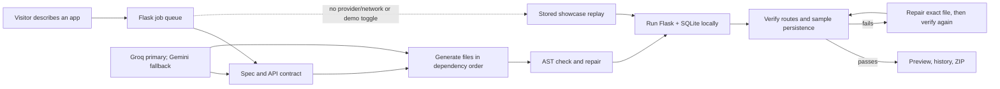

# ForgeAI

**ForgeAI turns a plain-English app idea into a running Flask + SQLite app—and checks that it works.**

<!-- Screenshot placeholder: add docs/assets/forgeai-workspace.png -->


<!-- Demo GIF placeholder: add docs/assets/forgeai-demo.gif -->


ForgeAI is a local-first college project exhibition demo for people who have an app idea but do not want to start with a blank code editor. Visitors can describe an app, watch ForgeAI build it, inspect the files and data blueprint, use the live preview, download the project, or request a focused change.

## How it works



1. The spec agent turns a prompt into an app description, entities, routes, and a shared API contract.
2. The code generator creates `requirements.txt`, `models.py`, `routes.py`, `app.py`, `index.html`, `style.css`, and `script.js` in dependency order. The Flask entry point is a deterministic template; the model does not generate that boilerplate.
3. Python files pass an `ast.parse` check before they are written. ForgeAI starts the app on an available local port.
4. The verifier calls contract GET routes, creates a temporary record, confirms SQLite persistence, exercises update/read-back/delete, and checks missing-record behavior. On failure, ForgeAI sends the failure and app logs to a repair step and verifies again.
5. The UI shows the build log, generated files, blueprint, preview, measured build time, and any repairs. A verified project can be downloaded as a ZIP.
6. When demo replay is forced, a prompt matches a showcase, or model-provider network access is unavailable, ForgeAI runs a locally stored showcase and labels it **Replay of a verified build**.

## Setup

ForgeAI uses Python 3.10 or newer. Install the backend requirements once while connected to a package source, then configure an AI provider if you want fresh generations.

```powershell
py -m venv .venv
.venv\Scripts\python.exe -m pip install -r backend\requirements.txt
Copy-Item .env.example .env
# Add GEMINI_API_KEY or GROQ_API_KEY to .env using a local editor.
.venv\Scripts\python.exe backend\app.py
```

Open <http://localhost:5000>. On Linux or macOS, use `python3 -m venv .venv`, activate it, install `backend/requirements.txt`, and run `python backend/app.py`.

### Optional local Ollama provider

ForgeAI can use an already-installed Ollama model without sending prompts to hosted providers. In the project-root `.env`, set:

```dotenv
LLM_PROVIDER=ollama
OLLAMA_BASE_URL=http://localhost:11434
OLLAMA_MODEL=qwen2.5-coder:1.5b
OLLAMA_NUM_CTX=4096
OLLAMA_MAX_OUTPUT_TOKENS=1024
OLLAMA_REQUEST_TIMEOUT_SECONDS=300
```

Start Ollama and confirm the model is available locally (`ollama list`), then restart ForgeAI. Ollama mode is local-only and ignores any configured hosted fallback. No additional Python package is needed. Local inference uses a 4,096-token context window and 1,024-token output cap. Each model request has a bounded 300-second timeout (`OLLAMA_REQUEST_TIMEOUT_SECONDS`, configurable from 30 to 600 seconds); generation runs in a background job, so this is a per-call limit, not a whole-build deadline.

For exhibition kiosk mode, `run.bat` (Windows) or `./run.sh` (Linux/macOS) starts the server and opens a kiosk browser when one is available. Run the setup and verify the demo before exhibition day. On startup, ForgeAI rebuilds and checks the six stored showcase presets. The **Demo replay** toggle forces one; familiar task, fitness, attendance, inventory, expense, and resume requests also match the local catalog. The UI identifies replayed builds.

Generated code runs locally on this machine with the same operating-system account as ForgeAI. Generated apps bind to `127.0.0.1`, expire after 30 minutes, and the server limits active generated apps. `/health` reports model-provider reachability, the active model, free disk space, and running generated apps. The `/preview/<job_id>/` proxy is reachable from a phone on the same Wi-Fi when ForgeAI is opened through the host computer's LAN address.

## Tech stack

- Python and Flask for job orchestration, status, health, history, downloads, and preview proxying
- Groq primary with Gemini fallback for eligible provider failures during spec and code generation
- Optional local-only Ollama provider using the installed Ollama service
- Generated Flask applications with Python's built-in `sqlite3`
- Vanilla HTML, CSS, and JavaScript for the UI; locally served assets and a local QR encoder, no frontend build step or CDN
- `pytest` for backend tests

## Quality checks

Run the test suite from `backend/` because its tests import `app` and `agent` as top-level modules:

```powershell
..\.venv\Scripts\python.exe -m pytest tests -q
```

The tests cover API-contract generation, Python AST validation, verification behavior, downloads, frontend support, modification planning, and showcase assets. The exhibition replay path was also exercised against a running local Flask app with its live route and SQLite checks.

## Limitations and safety

- Fresh app generation depends on an available configured model provider. The showcase replay keeps a prepared demo running without provider access; it is deliberately identified as a replay.
- Generated code is executed as a local subprocess and is **not sandboxed**. Do not enter secrets into prompts or use generated apps with sensitive data. Inspect downloaded code before reuse, and do not deploy it as-is.
- The verifier covers declared GET routes and one entity's temporary create/update/delete flow with SQLite persistence. It does not prove that every UI state, security property, or business rule is correct.
- Model output can be incomplete or wrong. Repair is bounded; a failed app still needs human review.
- This is a single-machine exhibition prototype. Jobs are serialized and local storage/process limits are designed for a demo, not multi-user production hosting.
- Model-provider usage may incur account charges. ForgeAI does not currently estimate or cap provider spend.
- The “~2 days” comparison is an illustrative baseline; the ForgeAI side uses the measured duration of the actual build.

## Future scope

Add stronger per-app isolation, richer domain-specific templates, broader UI and data tests, explicit provider cost controls, and a deployment workflow that includes security review.
